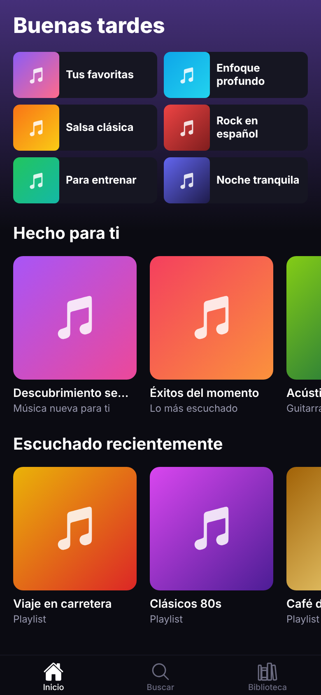

# Ritmo 🎵

App de música para Android e iOS, inspirada en Spotify pero con **diseño propio**:
tema oscuro, acentos en violeta y coral, y portadas con degradados.



## Cómo ejecutarla

```bash
cd ritmo-musica
npm install
npx expo start
```

Escanea el código QR con la app **Expo Go** (Android) o con la cámara (iOS).
Si guardas un archivo, la app se recarga sola en tu teléfono.

## Plan paso a paso

- [x] **Paso 1. Estructura y pantalla de Inicio**: proyecto Expo, navegación con pestañas, colores y datos de ejemplo.
- [ ] **Paso 2. Detalle de playlist**: abrir una playlist y ver su lista de canciones (navegación con parámetros).
- [ ] **Paso 3. Buscar**: campo de búsqueda que filtra canciones en tiempo real (estado con `useState`).
- [ ] **Paso 4. Reproductor**: reproducir audio real con `expo-audio`, barra de "reproduciendo ahora" y reproductor a pantalla completa.
- [ ] **Paso 5. Estado global**: compartir la canción actual entre pantallas (Context o Zustand).
- [ ] **Paso 6. Datos reales**: consumir una API pública de música con licencia libre.
- [ ] **Paso 7. Usuarios y favoritos**: inicio de sesión y biblioteca guardada en una base de datos (Supabase).
- [ ] **Paso 8. Publicación**: ícono, pantalla de carga y build para tiendas con EAS.

## Cómo está organizado el código

```
ritmo-musica/
├── src/
│   ├── app/                 ← Pantallas. Cada archivo es una ruta (Expo Router).
│   │   ├── _layout.tsx      ← Layout raíz (Stack)
│   │   └── (tabs)/          ← Grupo de pestañas
│   │       ├── _layout.tsx  ← Barra de pestañas inferior
│   │       ├── index.tsx    ← Inicio
│   │       ├── buscar.tsx   ← Buscar
│   │       └── biblioteca.tsx
│   ├── components/          ← Piezas reutilizables de la interfaz
│   ├── constants/theme.ts   ← Colores y espaciados
│   └── data/mock.ts         ← Datos de ejemplo
└── app.json                 ← Configuración de la app (nombre, íconos...)
```

## Conceptos que aprendes en el paso 1

1. **Expo Router**: la carpeta `src/app` define la navegación. Un archivo = una pantalla.
2. **Componentes y props**: `PlaylistCard` recibe una `playlist` y la dibuja; se reutiliza en varios lugares.
3. **Estilos con `StyleSheet`** y diseño con **Flexbox** (`flexDirection`, `gap`, `flex: 1`).
4. **Listas eficientes** con `FlatList` (carruseles horizontales).
5. **`Pressable`**: respuesta visual al tocar una tarjeta.
6. **Zonas seguras** (`SafeAreaView`) para no chocar con el notch.

### Ejercicios para practicar

- Cambia `accent` en `src/constants/theme.ts` y mira cómo cambia la app.
- Agrega una nueva sección "Tus artistas" en Inicio usando `PlaylistRow` con tus propios datos.
- Haz que el saludo incluya tu nombre: "Buenas tardes, Luis".
